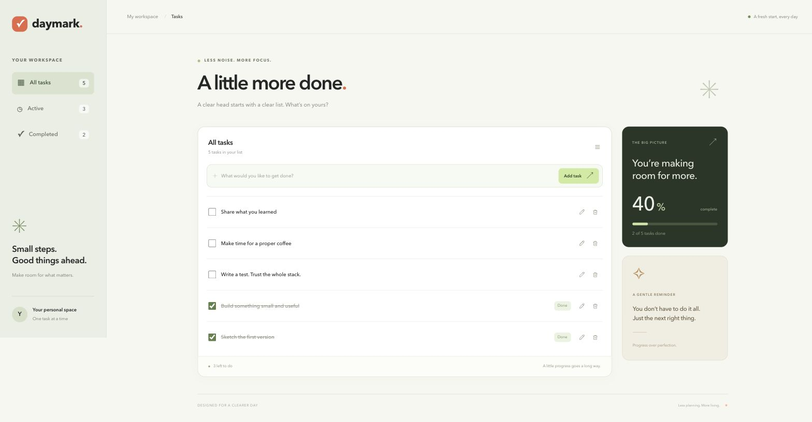
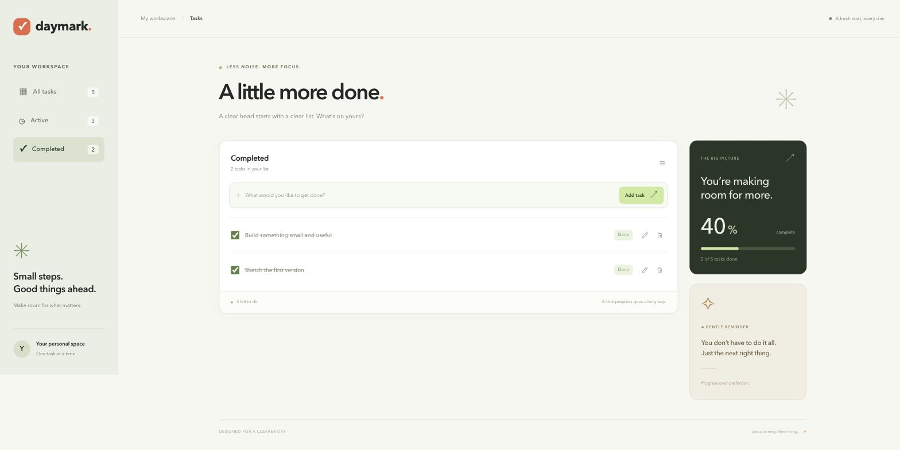

# Automated Browser Tests with Playwright and Testcontainers in .NET 10

Manual testing is exhausting and very repetitive. After N attempts, tester can lose focus and make mistakes. On the other hand, manual tests and integration tests are extremely useful to validate the code. However, they do not provide the full confidence over the expectations. That is why, end-to-end automated testing can be extremely useful to assess the quality and to guarantee no regressions are happening after pushing new changes.

In this walkthrough, we'll build automated tests that answer these questions using [Playwright for .NET](https://playwright.dev/dotnet/) and [Testcontainers](https://dotnet.testcontainers.org/). The browser will use a real Blazor Server application, which calls a minimal API, which writes to PostgreSQL. The test run starts everything it needs and cleans up afterwards.

The demo is **Daymark**, a small TODO app built with .NET 10, Entity Framework Core, PostgreSQL and Tailwind CSS. Aspire starts the application for local development. The automated tests have their own environment.



This tutorial covers:

- Starting PostgreSQL from C# using Testcontainers.
- Hosting both applications on real HTTP endpoints for the browser.
- Writing Playwright tests around user actions and persisted results.
- Keeping scenarios independent and saving useful diagnostics when they fail.

## Running the demo

You need the [.NET 10 SDK](https://dotnet.microsoft.com/download/dotnet/10.0), [Node.js](https://nodejs.org/) 20 or later, and a running Docker-compatible container runtime. Docker Desktop works on macOS and Windows; Linux containers must be available. The repository pins a .NET 10 SDK baseline and allows newer .NET 10 feature bands.

Run the following commands from the repository root:

```bash
npm ci --prefix src/web/Todo.Web
npm run build --prefix src/web/Todo.Web
dotnet tool restore
dotnet build Todo.slnx
```

Install the Chromium build required by our Playwright package. On macOS or Linux:

```bash
./scripts/playwright.sh install chromium
```

On Linux, install its operating system dependencies as well if needed:

```bash
./scripts/playwright.sh install --with-deps chromium
```

On Windows, use PowerShell:

```powershell
pwsh tests/web/Todo.AutomatedTests/bin/Debug/net10.0/playwright.ps1 install chromium
```

The shell helper uses the Playwright CLI shipped with the .NET package. This matters: a separately installed Playwright CLI might download a different browser version.

Launch the app:

```bash
dotnet run --project src/aspire/Todo.Host
```

Open **http://localhost:5200** for the frontend. Aspire prints the dashboard login link in the terminal. The backend is available at **http://localhost:5201**. This local demo uses HTTP and enables Aspire's unsecured transport setting in its development launch profile.

The development database uses a Docker volume, so tasks survive application restarts. The database starts empty on the first run; the screenshots contain tasks added through the browser. 

## A small application to test

The solution has six projects:

```text
src/
  aspire/
    Todo.Host                 Local orchestration
    Todo.ServiceDefaults      Discovery, health, resilience and telemetry
  backend/
    Todo.Backend              Minimal APIs, EF context and migrations
  common/
    Todo.Contracts            Shared API records and title rules
  web/
    Todo.Web                  Blazor Server and Tailwind
tests/
  web/
    Todo.AutomatedTests      Playwright scenarios and test fixture
```

The frontend is an HTTP client of the backend. Only the backend application opens database connections. 

Our only application table is `Todos`, with `Id`, `Title`, `IsCompleted` and `CreatedAt`. EF also creates its migration history table. The API has four operations:

| Method | Route | Behavior |
| --- | --- | --- |
| GET | `/api/todos` | List tasks, newest first |
| POST | `/api/todos` | Create a task and return it with status 201 |
| PUT | `/api/todos/{id}` | Update title and completion status |
| DELETE | `/api/todos/{id}` | Delete a task and return status 204 |

Titles are trimmed and must contain between 1 and 200 characters. Invalid titles return a validation problem with status 400; updating or deleting an unknown ID returns 404.

For example, the create endpoint is deliberately simple:

```csharp
group.MapPost("/", async (CreateTodoRequest request, TodoDbContext db,
    CancellationToken cancellationToken) =>
{
    if (!TodoRules.IsValidTitle(request.Title)) return InvalidTitle();
    var todo = new TodoEntity { Title = request.Title!.Trim() };
    db.Todos.Add(todo);
    await db.SaveChangesAsync(cancellationToken);
    return Results.Created($"/api/todos/{todo.Id}", Response(todo));
});
```

The backend registers its database through a bootstrapper called from `Program.cs`:

```csharp
public static IHostApplicationBuilder AddTodoDatabase(this IHostApplicationBuilder builder)
{
    builder.AddNpgsqlDbContext<TodoDbContext>("todos");
    builder.Services.AddHostedService<MigrationHostedService>();
    return builder;
}
```

`AddNpgsqlDbContext` reads the named connection from application configuration and registers the context, database health check and telemetry. Aspire supplies that connection in development; the test fixture supplies its container connection.

`MigrationHostedService.StartAsync` applies migrations before the backend accepts requests:

```csharp
public async Task StartAsync(CancellationToken cancellationToken)
{
    await using var scope = scopes.CreateAsyncScope();
    await scope.ServiceProvider.GetRequiredService<TodoDbContext>()
        .Database.MigrateAsync(cancellationToken);
}
```

EF CLI commands use the same application registration, without a separate design-time context factory. When running outside Aspire, pass the connection through configuration. For example, this model check does not require a running database:

```bash
dotnet ef migrations has-pending-model-changes --project src/backend/Todo.Backend -- --ConnectionStrings:todos "Host=localhost;Database=todos;Username=postgres;Password=postgres"
```

Use the intended database's actual connection string for commands that connect, such as `dotnet ef database update`.

## What Aspire does here

The AppHost starts PostgreSQL and connects the applications:

```csharp
var password = builder.AddParameter("postgres-password", "Password123", secret: true);
var database = builder.AddPostgres("postgres", password: password)
    .WithImageTag("17-alpine")
    .WithLifetime(ContainerLifetime.Persistent)
    .WithDataVolume().AddDatabase("todos");
var backend = builder.AddProject<Projects.Todo_Backend>("backend")
    .WithReference(database).WaitFor(database).WithHttpHealthCheck("/health");
builder.AddProject<Projects.Todo_Web>("web")
    .WithReference(backend).WaitFor(backend).WithHttpHealthCheck("/health")
    .WithExternalHttpEndpoints();
```

The local database uses `Password123` and a persistent container with a data volume, so its credentials and tasks remain consistent across development restarts.

Both applications reference `Todo.ServiceDefaults`. It adds service discovery, HTTP resilience, health checks and OpenTelemetry. When Aspire supplies an OTLP endpoint, telemetry is exported to the dashboard. The backend readiness check also checks database connectivity.

The web client uses `http://backend` as its base address. Service discovery resolves that name to the endpoint supplied by Aspire. HTTP retries are disabled for unsafe methods so that a failed POST isn't automatically sent again and potentially creates a duplicate task.

For tests, we will supply the backend discovery address ourselves. We don't need to start the dashboard or the development database.

## Starting PostgreSQL with Testcontainers

The test project uses xUnit to discover and run the automated browser scenarios. It references `Microsoft.Playwright`, `Testcontainers.PostgreSql` and `Microsoft.AspNetCore.Mvc.Testing`.

The database setup in `TodoAppFixture` is only a few lines:

```csharp
private readonly PostgreSqlContainer postgres =
    new PostgreSqlBuilder("postgres:17-alpine")
        .WithDatabase("todo_tests")
        .WithUsername("todo")
        .WithPassword("todo-test-password")
        .Build();
```

Then, during fixture initialization:

```csharp
await postgres.StartAsync();
backend = new BackendFactory(postgres.GetConnectionString());
```

Testcontainers waits for PostgreSQL readiness and gives us its mapped connection string. We don't choose a fixed database port. There is no shared development database to reset before running the tests, and no manually started container to remember.

Please note that the password above belongs to a disposable local test database. The fixture doesn't reuse Aspire's database or volume.

## Giving the browser real endpoints

An in-memory test server is convenient for HTTP client tests, but a browser needs a listening HTTP server. We use [`WebApplicationFactory.UseKestrel`](https://learn.microsoft.com/en-us/dotnet/api/microsoft.aspnetcore.mvc.testing.webapplicationfactory-1.usekestrel?view=aspnetcore-10.0) with port zero, allowing the operating system to pick an available port:

```csharp
private static Uri StartOnKestrel<T>(WebApplicationFactory<T> factory)
    where T : class
{
    factory.UseKestrel(0);
    using var client = factory.CreateClient();
    return client.BaseAddress!;
}
```

Each application exposes a distinct public marker, `BackendProgram` or `WebProgram`, so the factory can identify the correct application assembly.

The backend factory supplies the connection string before startup:

```csharp
private sealed class BackendFactory(string connectionString)
    : WebApplicationFactory<BackendProgram>
{
    protected override void ConfigureWebHost(IWebHostBuilder builder)
    {
        builder.UseEnvironment("Development");
        builder.UseSetting("ConnectionStrings:todos", connectionString);
        builder.UseSetting("Logging:LogLevel:Default", "Warning");
    }
}
```

The frontend factory supplies `services:backend:http:0` with the backend's actual URL. It also enables static web assets so that styles are served from the application when hosted by the tests.

The startup order is:

```csharp
await postgres.StartAsync();
backend = new BackendFactory(postgres.GetConnectionString());
var backendAddress = StartOnKestrel(backend);
web = new WebFactory(backendAddress);
BaseAddress = StartOnKestrel(web);
playwright = await Playwright.CreateAsync();
browser = await playwright.Chromium.LaunchAsync(new()
{
    Headless = Environment.GetEnvironmentVariable("HEADED") != "1"
});
```

The resulting path is the same one a person uses:

```text
Chromium → Blazor Server → HTTP API → EF Core → PostgreSQL
```

Blazor's circuit, HTTP serialization, routing and database writes are all involved. Nothing in that path is replaced by a mock.

## Keeping scenarios independent

Starting a database and both hosts for every assertion would be expensive. We share the fixture across one test class, while each scenario starts with an empty `Todos` table and a fresh browser context.

The reset uses a service scope from the test backend:

```csharp
public async Task ResetDatabase()
{
    await using var scope = backend!.Services.CreateAsyncScope();
    await scope.ServiceProvider.GetRequiredService<TodoDbContext>()
        .Todos.ExecuteDeleteAsync();
}
```

This is test setup, not a public reset endpoint. It leaves the migrated schema intact. All scenarios belong to the same xUnit class, which executes them sequentially; parallel scenarios would need separate databases or another isolation strategy.

A new browser context keeps cookies, storage and pages seperate between scenarios. The shared Chromium process avoids paying browser startup cost for every test.

## Writing the first browser test

Let's check that a task is actually saved. This is the creation scenario from the suite:

```csharp
[Fact]
public Task Create_a_task_and_keep_it_after_reload() =>
    app.RunScenario(nameof(Create_a_task_and_keep_it_after_reload), async page =>
    {
        await Expect(page.GetByText("A little space for a fresh start",
            new() { Exact = true })).ToBeVisibleAsync();
        await Add(page, "  Write the walkthrough  ");
        await Expect(Row(page, "Write the walkthrough")).ToBeVisibleAsync();
        await Expect(page.GetByLabel("New task", new() { Exact = true }))
            .ToHaveValueAsync("");
        await page.ReloadAsync();
        await Expect(Row(page, "Write the walkthrough")).ToBeVisibleAsync();
        await Expect(page.GetByText("1 left to do", new() { Exact = true }))
            .ToBeVisibleAsync();
    });
```

`RunScenario` opens the page, waits for the Add button to become enabled, runs the scenario, and checks for uncaught browser errors. `Add` fills the labeled input, clicks Add task and waits for the corresponding row.

The reload is a useful part of this test. Seeing a new row immediately after clicking Add could only demonstrate an in-memory UI update. Seeing it after a reload checks that the frontend can read it back through the backend and PostgreSQL.

Notice the spaces around the input title: the same scenario also checks trimming.

## Completion, filters and validation

The other scenarios use the same fixture and browser helpers. For example, completing a task is a user interaction followed by an observable result:

```csharp
var checkbox = page.GetByRole(AriaRole.Checkbox, new()
{
    Name = "Complete Run the browser tests",
    Exact = true
});
await checkbox.CheckAsync();
await Expect(page.GetByRole(AriaRole.Progressbar))
    .ToHaveAttributeAsync("aria-valuenow", "100");
await page.ReloadAsync();
await Expect(checkbox).ToBeCheckedAsync();
```

The filter scenario creates two tasks, completes one, and checks the All, Active and Completed views together with their counts.



We also cover empty, whitespace-only and overlong titles. These browser scenarios check that the user sees a validation message and no task is created. They exercise the frontend validation; they don't claim to test every backend validation response independently. The backend applies the shared rule as well.

The complete suite contains ten scenarios, including the three invalid-title cases:

| Scenario | What we check |
| --- | --- |
| Create | Empty state, trimmed title, cleared input and persistence |
| Edit | Updated title survives reload |
| Complete and reopen | Completion state and progress survive reload |
| Filters | Visible rows and counts follow completion |
| Delete | Removed task stays removed after reload |
| Invalid titles, three cases | Validation message and no persisted task |
| Invalid edit | Cancelling preserves the saved title |
| Mobile | Create and complete at 390 × 844, without horizontal overflow |

## Waiting for behavior

Browser tests become frustrating when they assume the application always responds within a fixed delay. Playwright's locators and assertions wait for the expected state, so we can write:

```csharp
await Expect(Row(page, "Publish the article")).ToBeVisibleAsync();
```

There are no `Thread.Sleep` or `Task.Delay` calls in the tests. We wait for a visible row, a checked checkbox or an updated progress value.

Most selectors use labels and roles, such as `GetByLabel("New task")`. This keeps the test close to what the user sees. The task row has one explicit `data-testid` so assertions can scope themselves to a particular task without depending on Tailwind classes.

## Running and investigating the tests

With Docker running and Chromium installed:

```bash
dotnet test Todo.slnx
```

You don't have to start Aspire first. The test command creates its own PostgreSQL container and application hosts. It also works while the development app is running because test listeners and the test database use dynamic ports.

To watch the browser on macOS or Linux:

```bash
HEADED=1 dotnet test Todo.slnx
```

In PowerShell:

```powershell
$env:HEADED = "1"
dotnet test Todo.slnx
Remove-Item Env:HEADED
```

When a scenario fails, `RunScenario` attempts to save `failure.png` and `trace.zip` in a unique directory under `TestResults` relative to the test runner's working directory. These artifacts are ignored by Git. To open a trace:

```bash
./scripts/playwright.sh show-trace /path/to/TestResults/scenario/trace.zip
```

The trace includes browser actions, DOM snapshots and screenshots. It is a lot more useful than only knowing that a button click timed out. The fixture disposes contexts, browser, hosts and database when the run finishes, and also cleans up if initialization fails.

If Chromium cannot be found, rerun the browser installation command after building. If the container cannot start, check that Docker is running and that the current user can access its socket. The first run may take longer while images and browsers are downloaded.

## Wrap-uo

In this article, I have shown how we use Playwright for automated testing of a .net app composed of backend, a frontend and aspire as a dev orchestration tool.

These tests bring a lot of confidence. They are most of the time much more complex than the case we are showing in this walkthrough.

At the companies I work with, we use also playwright for nightly runs and smoke tests to check that we did not introduce any issues to deployed apps.

The code of the app can be found [here](https://github.com/nubiquest-blogs/automated-tests-test-containers)

Enjoy!
